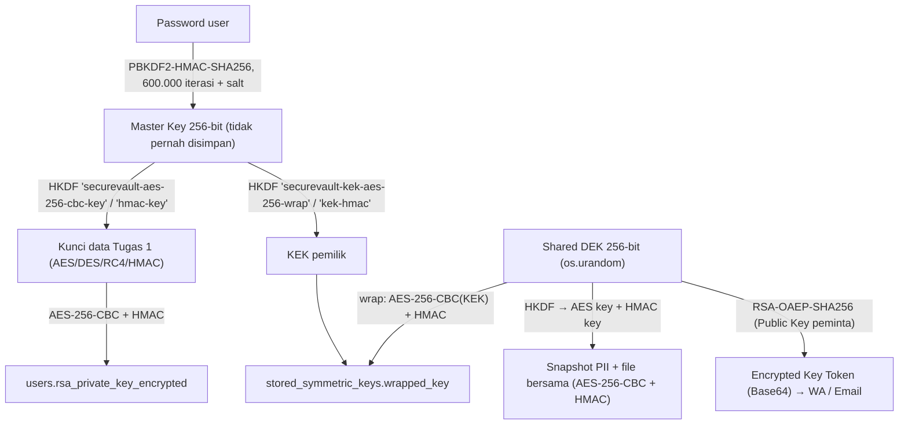
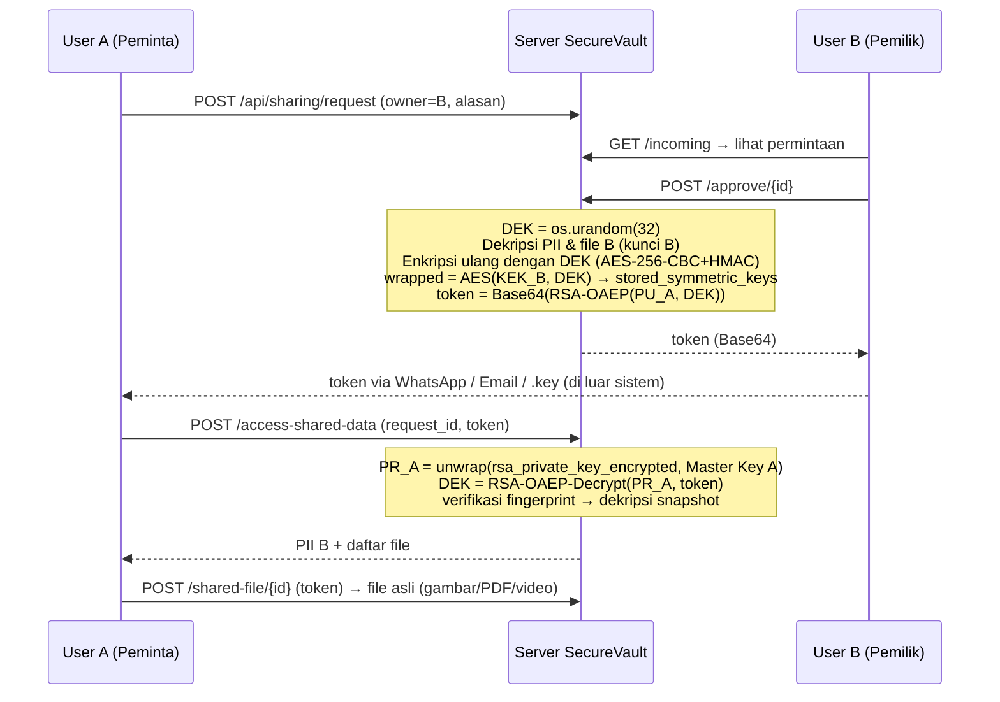

# LAPORAN TUGAS 2 — KEAMANAN INFORMASI
## *Key Management*: Distribusi Kunci Simetris dengan RSA-2048-OAEP & *Envelope Encryption*
### Proyek: SecureVault — HR e-KYC Vault

**Referensi utama:**
- William Stallings, *Cryptography and Network Security: Principles and Practice*, 7th Ed. — **Bab 9.1** (*Principles of Public-Key Cryptosystems*) dan **Bab 10.1** (*Symmetric Key Distribution Using Asymmetric Encryption*).
- OWASP *Key Management Cheat Sheet* dan OWASP *Cryptographic Storage Cheat Sheet*.

---

## 1. Ringkasan Kebutuhan & Pemenuhannya

| No | Kebutuhan Dosen | Cara Dipenuhi di SecureVault |
|:--:|:--|:--|
| 1 | User dapat meminta melihat data privat user lain (PII, gambar, dokumen, video) | Menu **Key Management & Sharing › B · Directory & Request Access** → `POST /api/sharing/request`. |
| 2 | User yang diminta (Pemilik) membangkitkan kunci simetris | Tombol **Approve & Generate Key** → `os.urandom(32)` (CSPRNG) menghasilkan **Shared Symmetric Key / DEK 256-bit**; seluruh PII & file pemilik dienkripsi ulang dengan kunci ini. |
| 3 | Kunci simetris didistribusikan melalui cara lain, terenkripsi asimetris | DEK dienkripsi **RSA-2048-OAEP (SHA-256)** memakai *public key* peminta → Base64. Dikirim lewat **WhatsApp / Email / Copy / file `.key`**. |
| 4 | Semua kunci simetris disimpan aman di sistem | DEK hanya disimpan dalam bentuk **ter-wrap** (AES-256-CBC + HMAC-SHA256 dengan KEK). *Private key* RSA juga disimpan ter-wrap. Tidak ada kunci mentah di database. |

---

## 2. Hierarki Kunci (KEK vs DEK) dan *Envelope Encryption*

Stallings (Bab 10.1) membedakan **kunci induk/KEK** (*Key Encryption Key*, berumur panjang, hanya untuk mengenkripsi kunci lain) dan **kunci sesi/DEK** (*Data Encryption Key*, untuk mengenkripsi data). OWASP menyebut pola ini **Envelope Encryption / Key Wrapping**: data dienkripsi oleh DEK, lalu DEK dienkripsi oleh KEK, sehingga yang tersimpan hanyalah "amplop" terenkripsi.



### 2.1 Lapisan-lapisan kunci

| Lapisan | Kunci | Lokasi Penyimpanan | Perlindungan |
|:--|:--|:--|:--|
| Akar | Password | Tidak disimpan (hanya hash bcrypt) | — |
| L1 | Master Key | Tidak disimpan; hanya di JWT terenkripsi Fernet selama sesi | PBKDF2 600k iterasi |
| L2 | KEK & kunci data (HKDF) | Diturunkan ulang tiap request | Pemisahan kunci HKDF (*context* berbeda) |
| L3a | *Private key* RSA-2048 | `users.rsa_private_key_encrypted` | AES-256-CBC + HMAC-SHA256 (Encrypt-then-MAC) |
| L3b | Shared DEK | `stored_symmetric_keys.wrapped_key` (96 byte) | AES-256-CBC(KEK) + HMAC-SHA256 |
| Publik | *Public key* RSA | `users.rsa_public_key` (PEM, plaintext) | Memang publik |

Format `wrapped_key` (96 byte): `IV (16) ‖ Ciphertext (48 = 32 byte DEK + 16 byte padding PKCS#7) ‖ HMAC-SHA256 (32)`.

### 2.2 Mengapa ini aman?
- **Database bocor ≠ kunci bocor.** Penyerang yang mencuri `securevault.db` hanya mendapat *wrapped key* dan *private key* terenkripsi; untuk membukanya ia butuh Master Key, yang hanya dapat diturunkan dari password (PBKDF2 600k iterasi).
- **Pemisahan kunci (key separation).** KEK diturunkan dengan *context* HKDF berbeda dari kunci data Tugas 1, sehingga kunci pembungkus tidak pernah dipakai untuk mengenkripsi data (OWASP: *"a key should be used for a single purpose"*).
- **Integritas.** Semua ciphertext memakai Encrypt-then-MAC; manipulasi 1 bit pun ditolak sebelum dekripsi (mencegah *padding oracle*).
- **Revocation / crypto-shredding.** Pemilik dapat menekan **Revoke**: snapshot, file bersama, dan *wrapped DEK* dihapus, sehingga token yang sudah terkirim via WA/Email menjadi tidak berguna.

---

## 3. Mengapa RSA-2048 dengan *Padding* OAEP?

Menurut Stallings Bab 9.1, kriptosistem kunci publik menyediakan **kerahasiaan** bila pesan dienkripsi dengan **kunci publik penerima**: `C = E(PU_b, M)` dan hanya `M = D(PR_b, C)` yang bisa membukanya. Bab 10.1 menjelaskan bahwa kripto asimetris terlalu lambat untuk data besar, sehingga dipakai **hanya untuk mendistribusikan kunci sesi**, sementara data dienkripsi secara simetris (AES). Inilah yang kami lakukan:

1. **Saluran tidak tepercaya.** WhatsApp/Email bisa disadap, di-*forward*, atau tersimpan di *cloud backup*. Karena token = `RSA-OAEP(PU_peminta, DEK)`, siapa pun yang melihatnya tanpa *private key* peminta tidak dapat memperoleh DEK.
2. **Tidak perlu saluran rahasia sebelumnya.** Masalah klasik distribusi kunci simetris (n(n−1)/2 kunci, perlu *pre-shared secret*) diselesaikan: cukup *public key* peminta yang memang boleh diketahui publik.
3. **RSA-2048.** OWASP & NIST SP 800-57 menetapkan RSA minimal 2048 bit (≈112-bit security) untuk penggunaan hingga 2030.
4. **OAEP, bukan textbook RSA / PKCS#1 v1.5.**
   - *Textbook RSA* deterministik (pesan sama → ciphertext sama) dan *malleable*.
   - PKCS#1 v1.5 rentan serangan **Bleichenbacher** (*padding oracle*).
   - **OAEP** (Optimal Asymmetric Encryption Padding, dengan SHA-256 & MGF1) bersifat **probabilistik** (setiap enkripsi berbeda) dan memiliki pemeriksaan integritas internal; ciphertext yang dimanipulasi akan **ditolak**. Di aplikasi, token yang diubah 1 bit menghasilkan error:
     `RSA-OAEP Decryption Failed: Invalid Key or Corrupted Ciphertext`.
5. **Kapasitas.** RSA-2048-OAEP-SHA256 mampu mengenkripsi hingga 256 − 2·32 − 2 = 190 byte; DEK kami 32 byte — sangat cukup. Ciphertext selalu 256 byte (≈344 karakter Base64), mudah dikirim lewat chat.
6. **Binding kunci ke permintaan.** Sistem menyimpan *fingerprint* `SHA-256(DEK)[:16]` per permintaan; token milik permintaan lain akan ditolak (*Key mismatch*).

---

## 4. Alur Protokol Lengkap



Catatan penting: endpoint `GET /outgoing` milik peminta **sengaja tidak mengembalikan token**, sehingga kunci benar-benar hanya sampai ke peminta melalui "cara lain" sesuai soal.

---

## 5. Kompatibilitas dengan Tugas 1

- Saat startup, `database.py::_migrate_assignment2()` menambahkan kolom `rsa_public_key` & `rsa_private_key_encrypted` ke tabel `users` lama via `ALTER TABLE` (tanpa menghapus data).
- User Tugas 1 yang belum punya kunci RSA akan otomatis dibuatkan pasangan kunci saat **login** berikutnya (dibungkus dengan Master Key dari password login).
- Fitur Auth, PII, Upload/Download AES/DES/RC4, Benchmark & Hex Inspector tidak diubah dan diuji ulang pada skrip E2E.

---

## 6. Panduan Demo untuk Dosen (Simulasi User A & User B)

**Persiapan:** jalankan backend (`uvicorn app.main:app --reload --port 8000` di folder `backend`) dan frontend (`npm run dev` di folder `frontend`). Gunakan dua browser berbeda (atau satu jendela *Incognito*) agar dua sesi login berjalan bersamaan.

| Langkah | Siapa | Aksi | Yang Ditunjukkan ke Dosen |
|:--:|:--:|:--|:--|
| 1 | B | Register `bob_owner` → isi **Personal Profile** (Nama, NIK, TTL, Alamat) → **Upload** KTP (PNG, AES), CV (PDF, DES), video (MP4, RC4) | Fitur Tugas 1 tetap berjalan. |
| 2 | A | Register `alice_hr` → buka **Key Management & Sharing** | **Section A**: Public Key PEM, *Encrypted Private Key* (hex) — tidak ada PEM privat di DB. |
| 3 | A | Section **B**: isi alasan "HR Background Check Verification" → **Request Private Data Access** ke `bob_owner` | Status `PENDING` di Section D. |
| 4 | B | Refresh → Section **C** → **Approve & Generate Key** | Modal berisi token Base64 (256 byte). Tunjukkan tombol **Copy**, **WhatsApp**, **Email**, **Download .key**. |
| 5 | B | Tutup modal → Section **A** | Muncul *Wrapped Symmetric Key* (96 byte hex) — bukti DEK disimpan terenkripsi. (Opsional: buka `securevault.db` dengan DB Browser for SQLite, tabel `stored_symmetric_keys`.) |
| 6 | B → A | Kirim token via WhatsApp / Email (atau Copy-Paste / file `.key`) | Distribusi kunci di luar sistem (*out-of-band*). |
| 7 | A | Menu **Shared With Me** → tempel token → **Unlock Private Data & Files** | PII Bob terdekripsi + tabel file; tombol **Preview** (gambar/video/PDF) & **Decrypt & Download**. |
| 8 | A | **Uji negatif:** ubah 1 karakter token → Unlock | Error `RSA-OAEP Decryption Failed: Invalid Key or Corrupted Ciphertext`. |
| 9 | Eve | (Opsional) user ketiga mencoba token yang sama | Ditolak (403) — token hanya bisa dibuka oleh *private key* Alice. |
| 10 | B | Section C › History › **Revoke** | Token Alice tidak lagi bisa membuka data (*crypto-shredding*). |

**Verifikasi otomatis** (34 pemeriksaan):
```powershell
cd backend
python tests/e2e_assignment2.py
```

---

## 7. Peta File Implementasi

| File | Isi |
|:--|:--|
| `backend/app/crypto/rsa_cipher.py` | Generate RSA-2048, wrap/unwrap private key, RSA-OAEP-SHA256 enkripsi/dekripsi, Base64 token, fingerprint. |
| `backend/app/utils/security.py` | `derive_kek()`, `derive_shared_dek_keys()`, `key_fingerprint()`. |
| `backend/app/models.py` | Kolom RSA di `User`; tabel `AccessRequest`, `StoredSymmetricKey`, `SharedFile`. |
| `backend/app/database.py` | Migrasi kolom otomatis untuk DB Tugas 1. |
| `backend/app/routes/auth.py` | `ensure_rsa_keys()` saat register & login (backfill). |
| `backend/app/routes/sharing.py` | Seluruh endpoint permintaan, persetujuan, distribusi, akses, revoke. |
| `frontend/app/dashboard/sharing/page.tsx` | Section A–D + modal distribusi (WA/Email/Copy/.key). |
| `frontend/app/dashboard/shared/page.tsx`, `sharing/OutgoingRequests.tsx` | Halaman *Shared With Me*: tempel token, lihat PII, preview/unduh file. |
| `backend/tests/e2e_assignment2.py` | Uji end-to-end + regresi Tugas 1. |

---

## 8. Keterbatasan & Catatan Desain

- Snapshot bersifat **statis**: perubahan data pemilik setelah persetujuan tidak ikut terbagi (perlu permintaan baru). Ini disengaja agar pemilik tahu persis apa yang ia bagikan.
- Dekripsi RSA dilakukan di server (bukan di browser) karena *private key* dibungkus dengan Master Key sesi yang ada di server; *private key* hanya ada di memori selama request.
- Kunci sistem `SERVER_SECRET` (untuk Fernet di JWT) wajib diisi di `.env` pada produksi; jika tidak, nilai acak per-proses membuat sesi hilang saat server restart (tidak memengaruhi data tersimpan).
